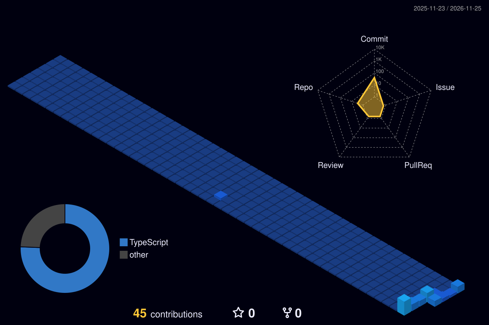

  

  

   
  

---

## 🧑‍💻 About Me

> *Building things from scratch, one late-night commit at a time.*

- 🔭 Currently working on [**MEDIQUEUE**](https://github.com/harshiig-12/MEDIQUEUE)
- 🌱 Deep-diving into `C` `C++` `Java` and **Data Structures & Algorithms**
- 🛠️ Exploring **PostgreSQL** and shipping web projects
- 🤝 Open to collaborating on **real-world apps & open-source tools**
- 📫 Reach me at **[harshalgarg1277@gmail.com](mailto:harshalgarg1277@gmail.com)**
- ⚡ Fun fact: **My best debugging happens after midnight.**

---

## 🛠️ Tech Stack

  

---

## 🚀 Featured Projects

| Project | Description | Tech Stack |
| :--- | :--- | :--- |
| [**MEDIQUEUE**](https://github.com/harshiig-12/MEDIQUEUE) | Streamlining medical appointments and queue management. | `PostgreSQL` `Java` |
| [**EDUGRID**](https://github.com/harshiig-12/EDUGRID) | Smart, algorithm-driven scheduling for conflict-free campus classrooms. | `C` `Algorithms` |

---

## 📊 GitHub Stats

  
  
   
  

---

## 🏙️ 3D Contribution Skyline

  

## 🌐 Connect With Me

  
 
  
 

    
  

